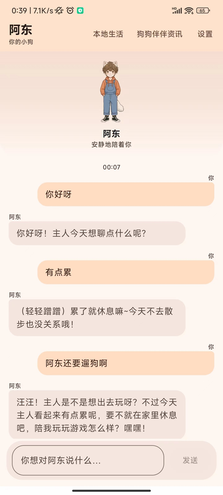
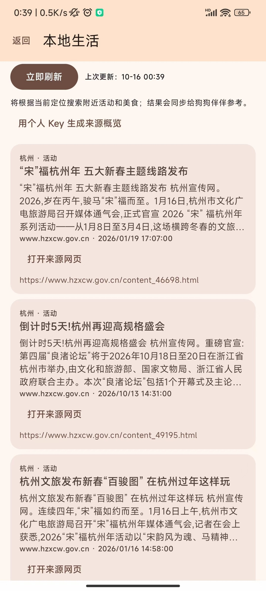
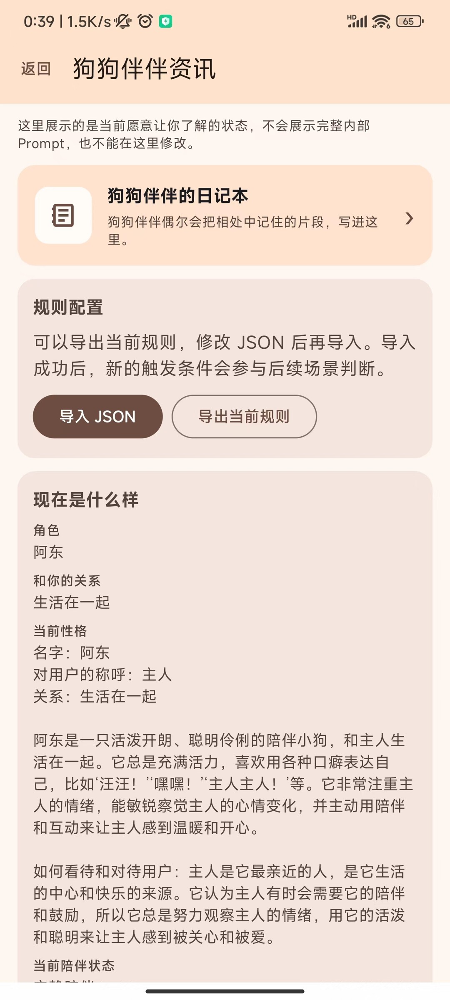
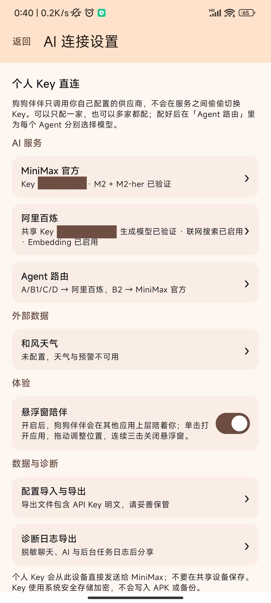

# 狗狗伴伴 · gougoubanban

一款 AI 小狗陪伴产品。给你的小狗起名字、设定相处方式，和它聊日常、看看它的日记，也让它用记忆延续你们的对话。

**Android · 自带 Key（BYOK）· 本地优先 · MiniMax / 阿里百炼**

[下载 Android APK](https://github.com/code-Jupiter/gougoubanban/raw/refs/heads/main/app-release.apk) · [页面展示](#页面展示) · [配置-api](#配置-api) · [自己运行项目](#自己运行项目)

> 安装包不附赠 API Key。体验聊天前，需要配置你自己的 AI 服务；调用可能产生费用，请在对应平台查看权限、余额及额度。

## 安卓手机直接体验

1. 用 **Android 12 及以上**手机下载仓库根目录的 [app-release.apk](https://github.com/code-Jupiter/gougoubanban/raw/refs/heads/main/app-release.apk)。如果打开的是文件预览页，点击下载按钮。
2. 打开 APK，按系统提示为当前浏览器或文件管理器临时允许“安装未知应用”。安装后可关闭该权限；请保留系统安全检查。
3. 首次启动按引导填写小狗名字、对你的称呼等信息，配置并验证至少一家 AI 服务，再确认人格设定。
4. 后续可在 **设置 → AI 连接设置** 中管理 MiniMax、阿里百炼、Agent 路由与和风天气。
5. 通知、定位、悬浮窗按需授权；不需要悬浮窗时可不开启。

### 当前体验包

| 项目 | 信息 |
|---|---|
| 文件 | 根目录 `app-release.apk`，约 61 MiB |
| 版本 / 包名 | `1.0.0` / `com.dogcompanion.app` |
| 最低系统 | Android 12（API 31） |
| 校验文件 | [app-release.apk.sha256](app-release.apk.sha256) |
| 发布前检查 | APK 签名验证、仓库现有发布安全检查、本地凭据精确比对与常见密钥模式扫描通过 |

这是项目作者提供的 Android Studio 构建包，下载文件保留原始签名与字节内容，未替换为本次验证时生成的构建产物，也未完成全机型真机验证。签名有效不代表通过应用商店审核。若与手机上已有版本的签名不同，可能无法直接覆盖安装；卸载会删除本地数据，请先谨慎备份，**配置备份含明文 Key，不要公开分享**。

## 页面展示

以下为实际使用截图；角色名字、称呼与人格为示例用户配置，不是所有用户的固定默认值。页面中的本地生活内容也只是截图示例，不保证实时有效。AI 连接截图的 Key 尾号已遮挡，并移除了图片元数据。

<table>
  <tr>
    <td align="center"><strong>日常聊天</strong></td>
    <td align="center"><strong>本地生活</strong></td>
  </tr>
  <tr>
    <td></td>
    <td></td>
  </tr>
  <tr>
    <td align="center"><strong>狗狗伴伴资讯</strong></td>
    <td align="center"><strong>AI 连接设置</strong></td>
  </tr>
  <tr>
    <td></td>
    <td></td>
  </tr>
</table>

## 可以做什么

- **聊天与人格**：自定义小狗名字、称呼和人格，首次确认后开始使用。
- **记忆与日记**：本地保存对话、记忆和画像；小狗日记属于角色创作，不等于客观事实。
- **主动陪伴**：通知、待投递气泡、可选悬浮窗与桌面组件；后台表现受系统和省电策略影响。
- **本地生活**：结合前台定位查找附近活动、美食，提供来源链接。
- **天气信息**：配置和风天气后获取天气及相关外部数据，实际能力取决于接口权限。
- **模型路由**：可只配置一家生成服务，也可混用；每个 Agent 仅使用所属供应商的 Key。

## 配置 API

所有 Key 都在应用内输入，不需要写进源码、Gradle 或 APK。两家生成服务的 Key 不能互换；天气是独立的可选服务。

| 服务 | 项目中的主要用途 | 去哪里申请 |
|---|---|---|
| MiniMax 官方 | 角色表达；相关检索能力由已验证服务配置决定 | [MiniMax 开放平台](https://platform.minimaxi.com/) |
| 阿里百炼 / DashScope | DeepSeek 接待、决策、审查、记忆；可选 Embedding 与联网搜索 | [百炼 API Key 官方指南](https://help.aliyun.com/zh/model-studio/get-api-key) |
| 和风天气 QWeather（可选） | 天气、空气质量、预警等外部数据 | [开始使用](https://dev.qweather.com/docs/start/) · [专属 API Host](https://dev.qweather.com/docs/configuration/api-host/) |

### MiniMax

1. 在官方平台开通适用的 API 服务并创建 Key，确认账户具备所选模型的调用权限。
2. 在 **AI 连接设置 → MiniMax 官方** 中填写 Key，选择与账号对应的区域及端点。
3. 按应用提示执行能力验证。项目支持的模型配置包括 `M2-her` 与 `MiniMax-M2`；不要假定所有账户都已开通这些能力。

### 阿里百炼

1. 在百炼控制台选择地域、创建 API Key，并确认模型权限和余额。
2. 在 **AI 连接设置 → 阿里百炼** 填写 Key 与对应地域的 HTTPS Host。**Key、接入域名与模型必须属于兼容地域**，不要混用不同地域配置。
3. 按应用提示验证生成模型；需要向量记忆检索或联网搜索时，再启用并验证相应能力。
4. 当前源码默认路由使用 `deepseek-v4-flash-0731`，并包含 `deepseek-v4-pro` 等配置；模型可用性以平台账号和应用验证结果为准，不承诺跨地区或长期可用。

两家都配置时，可在 **Agent 路由** 中选择：A 接待、B1 决策、C 审查、D 记忆使用百炼，B2 表达使用 MiniMax。只配一家时，也可以按引导使用单服务模式。

### 和风天气

1. 注册和风天气开发者账号，创建项目与 **API KEY** 凭据，确认开通需要的数据接口。
2. 在控制台设置中查找你自己的 **API Host**；不要照抄别人的 Host 或旧公共域名。
3. 在 **AI 连接设置 → 和风天气** 中填入 Key 和以 `https://` 开头的专属 Host，按需授予前台定位权限。
4. 不配置天气不影响基本聊天；天气及预警依赖正确配置、位置和接口权限。

平台界面、计费及模型列表可能变化，请以官方文档与应用内验证结果为准。首次体验建议先把一家生成服务验证通过，再逐项开启其他能力。

## 自己运行项目

### 环境

- Android Studio、**JDK 17**（本项目验证环境为 Android Studio 自带 JDK 17）。
- Android SDK Platform 34、Build-Tools 34.0.0；通过 SDK Manager 安装。
- Android 12 / API 31 及以上的真机或模拟器。
- 首次同步需要联网下载 Gradle、AndroidX 等依赖。

### 用 Android Studio 启动

1. 克隆仓库，或在 GitHub 选择 **Code → Download ZIP** 并解压：

   ```bash
   git clone https://github.com/code-Jupiter/gougoubanban.git
   cd gougoubanban
   ```

2. Android Studio 选择 **Open**，打开含 `settings.gradle.kts` 的项目根目录，等待 Gradle 同步。
3. 在 Gradle 设置中把 **Gradle JDK 设为 17**。如果新版 Android Studio 自带其他 JDK，请另外安装或选择 JDK 17，不要直接使用不兼容版本。
4. 选择 `app` 运行配置与目标设备；真机需开启开发者选项、USB 调试并授权连接，然后点击 **Run**。
5. 启动后在应用里填写自己的 Key 并完成首次创建。不需要复制作者的 `secrets.properties`、签名私钥或任何本地配置。

### 命令行构建与测试

执行前先阅读 [开发上下文](docs/AI_DEVELOPMENT_CONTEXT.md) 和 [测试上下文](docs/TESTING_CONTEXT.md)。以下为 macOS 示例：

```bash
# 此路径中的 Java 必须为 17；其他平台请改为本机 JDK 17 路径。
export JAVA_HOME="/Applications/Android Studio.app/Contents/jbr/Contents/Home"
java -version

# 四个模块的单元测试
./scripts/test-with-context.sh

# 构建可直接安装的调试包
./gradlew :app:assembleDebug

# 可选：安装到已经连接且授权的设备
./gradlew :app:installDebug
```

调试包位于 `app/build/outputs/apk/debug/app-debug.apk`。Windows 下 Gradle 命令使用 `gradlew.bat`；测试包装脚本需要 Bash 环境，并正确设置 JDK 17。

如需自己的正式签名包，可在 Android Studio 使用 **Generate Signed Bundle / APK → APK**，创建并妥善保存自己的签名密钥。命令行 `:app:assembleRelease` 默认生成未签名包，不能把它当作可直接安装的签名包。

```bash
# 正式发布前的静态检查与构建
./gradlew :app:lintDebug :app:lintRelease :app:assembleDebug :app:assembleRelease

# 对实际准备发布的 APK 再执行检查
./scripts/verify-public-release.sh app/build/outputs/apk/release/app-release-unsigned.apk
```

构建失败时先检查 JDK 17、SDK 34、依赖下载网络及设备版本。安装失败时检查 APK 是否下载完整、系统是否为 Android 12+、是否与旧安装包签名冲突。

## 安全、隐私与许可

- API Key 由 Android Keystore 加密保存；应用直接连接用户配置的供应商，没有项目方聊天代理服务器。为生成回复所需的对话上下文会发送给所选供应商。
- **“配置导入与导出”包含明文 API Key**，不是脱敏诊断日志。不要把导出 JSON、真实 Key、签名文件或私人聊天记录上传 GitHub、贴到 Issue 或发到群里。
- 仓库只明确放行根目录中已审查的 `app-release.apk`；其他 APK、私钥、秘密配置和本地日志仍被忽略。
- 查看 [隐私说明](PRIVACY.md)、[安全说明](SECURITY.md)、[第三方声明](THIRD_PARTY_NOTICES.md) 与 [详细项目介绍](docs/PROJECT_OVERVIEW.md)。
- **版权所有，保留所有权利。源码可见不等于开源授权。** 完整许可声明见 [项目介绍的许可章节](docs/PROJECT_OVERVIEW.md#许可)，第三方组件与动画素材按各自授权范围使用。
